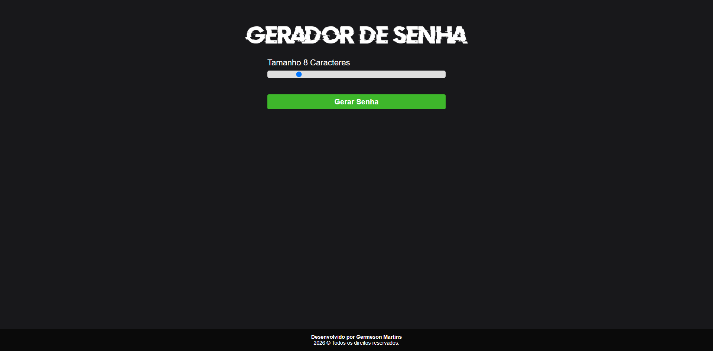

# Gerador de Senha Aleatória
Projeto desenvolvido para estudo, com o objetivo de criar um gerador de senhas aleatórias, permitindo ao usuário definir o tamanho dos caracteres. O projeto também trabalha conceitos de JavaScript, manipulação do DOM e interação com o usuário.

##  Tecnologias utilizadas

    
    
    

## 🛠️ Ferramentas

    
    

## 🌐 Deploy

Acesse o projeto online:

## 🖥️ Demonstração
